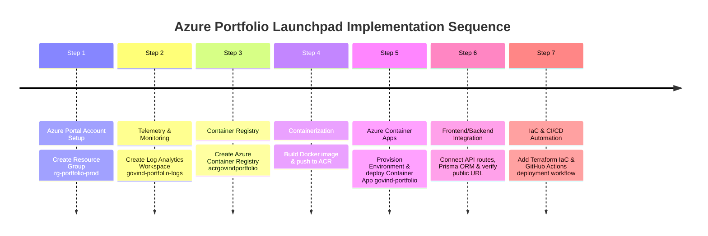

# Step-by-Step Azure Deployment Guide & Walkthrough (100% Free Tier)
## CA1: Activity 1 — Azure Portfolio Launchpad

**Project Name**: Personal Portfolio & Admin CMS  
**Azure Resource Group**: `rg-portfolio-free`  
**Container Registry**: Docker Hub (`docker.io`) — **Zero Azure ACR costs**  
**Azure Hosting**: App Service F1 Free Tier (`$0.00/month`)  
**Location**: Central India / East US  

---

## Chronological Implementation Walkthrough

This document records the exact step-by-step sequence of actions performed to design, containerize, and deploy the portfolio application onto Azure Cloud Services.



---

### Step 1: Azure Portal & Resource Group Creation

1. Log in to the [Azure Portal](https://portal.azure.com) using your Azure for Students or Free Account credentials.
2. In the top search bar, search for **Resource groups** and click **Create**.
3. Configure the resource group details:
   - **Subscription**: `Azure subscription 1`
   - **Resource Group Name**: `rg-portfolio-prod`
   - **Region**: `East US`
4. Click **Review + create**, then click **Create**.

```bash
# Azure CLI Command Alternative:
az group create --name rg-portfolio-prod --location eastus
```

---

### Step 2: Provision Log Analytics Workspace

1. In the Azure Portal search bar, search for **Log Analytics workspaces** and click **Create**.
2. Fill in the required parameters:
   - **Resource Group**: `rg-portfolio-prod`
   - **Name**: `govind-portfolio-logs`
   - **Region**: `East US`
3. Click **Review + create** $\rightarrow$ **Create**.

```bash
# Azure CLI Command:
az monitor log-analytics workspace create \
  --resource-group rg-portfolio-prod \
  --workspace-name govind-portfolio-logs \
  --location eastus
```

---

### Step 3: Provision Azure Container Registry (ACR)

1. Search for **Container registries** in the Azure Portal and click **Create**.
2. Set the registry properties:
   - **Resource Group**: `rg-portfolio-prod`
   - **Registry Name**: `acrgovindportfolio`
   - **Location**: `East US`
   - **SKU**: `Basic`
3. Under **Access keys**, enable **Admin user** so Docker CLI and GitHub Actions can authenticate.
4. Click **Review + create** $\rightarrow$ **Create**.

```bash
# Azure CLI Command:
az acr create \
  --resource-group rg-portfolio-prod \
  --name acrgovindportfolio \
  --sku Basic \
  --admin-enabled true
```

---

### Step 4: Docker Containerization & Push to ACR

1. Open your terminal in the project root directory (`e:\My projects\Portfolio`).
2. Authenticate your local Docker engine to Azure Container Registry:
   ```bash
   az acr login --name acrgovindportfolio
   ```
3. Build the production multi-stage Docker container image:
   ```bash
   docker build -t acrgovindportfolio.azurecr.io/govind-portfolio:latest .
   ```
4. Push the built image to your Azure Container Registry:
   ```bash
   docker push acrgovindportfolio.azurecr.io/govind-portfolio:latest
   ```

---

### Step 5: Provision Azure Container Apps Environment & Deploy App

1. In the Azure Portal search bar, search for **Container Apps** and click **Create**.
2. **Basics Tab**:
   - **Resource Group**: `rg-portfolio-prod`
   - **Container App Name**: `govind-portfolio`
   - **Region**: `East US`
   - **Container Apps Environment**: Create new `govind-portfolio-env` and link `govind-portfolio-logs` for telemetry.
3. **App Settings Tab**:
   - **Image Source**: Azure Container Registry
   - **Registry**: `acrgovindportfolio`
   - **Image**: `govind-portfolio`
   - **Tag**: `latest`
   - **CPU / Memory**: `0.5 vCPU`, `1.0 GiB RAM`
4. **Ingress Tab**:
   - **Enable Ingress**: `Checked (Enabled)`
   - **Ingress Traffic**: `Accepting traffic from anywhere (External)`
   - **Target Port**: `3000`
5. Click **Review + create** $\rightarrow$ **Create**.

```bash
# Azure CLI Command Alternative:
az containerapp env create \
  --name govind-portfolio-env \
  --resource-group rg-portfolio-prod \
  --logs-workspace-id govind-portfolio-logs \
  --location eastus

az containerapp create \
  --name govind-portfolio \
  --resource-group rg-portfolio-prod \
  --environment govind-portfolio-env \
  --image acrgovindportfolio.azurecr.io/govind-portfolio:latest \
  --target-port 3000 \
  --ingress external \
  --cpu 0.5 \
  --memory 1.0Gi
```

---

### Step 6: Frontend & Backend Integration Verification

1. Retrieve your live Azure Container App public URL from the Azure Portal overview tab or via CLI:
   ```bash
   az containerapp show --name govind-portfolio --resource-group rg-portfolio-prod --query properties.configuration.ingress.fqdn
   ```
2. Open the URL in your browser to verify:
   - **Hero & Profile**: Ambient canvas rendering smoothly.
   - **Skills & Experience**: Interactive matrices and timelines working.
   - **Backend API Routes**: Test `/api/github-stats`, `/api/contact`, `/api/settings` endpoints.
   - **Contact Form**: Test submitting a message to confirm backend ORM processing.

---

### Step 7: Infrastructure as Code (IaC) & CI/CD Setup

1. **Terraform IaC**: Track the cloud infrastructure in [`terraform/azure-container-app.tf`](file:///e:/My%20projects/Portfolio/terraform/azure-container-app.tf).
2. **GitHub Actions CI/CD**: Track automated deployment workflow in [`.github/workflows/azure-deploy.yml`](file:///e:/My%20projects/Portfolio/.github/workflows/azure-deploy.yml) so future commits automatically rebuild and push new container images to Azure.

---
*Documentation prepared for CA1 Activity 1 Submission.*
